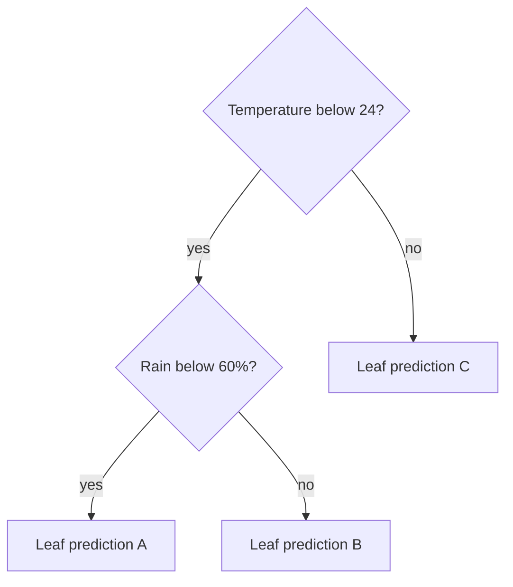

# Decision trees, overfitting and forests

TC03 · extracted 4 November 2026. The reel is titled **Decision Trees**, part 25
of *AI Foundations from Scratch*, by Between The Tokens. Its frames show temperature
and rain thresholds, Gini impurity, increasing depth and a forest vote. This is
the identified source of the decision-cascade idea, not a separate named algorithm.

A tree learns successive feature tests and sends each example to a leaf prediction.
Deeper trees can express finer distinctions and overfit. Depth limits, minimum
leaf sizes and pruning constrain this growth. Choose constraints using validation
rather than training accuracy alone.
[scikit-learn decision-tree documentation](https://scikit-learn.org/stable/modules/tree.html).

For classification, Gini impurity is `1 − Σ p(class)²`. A split is evaluated using
the sample-weighted impurities of its children. For two classes this becomes
`2p(1−p)`: zero for a pure node and 0.5 for an even mixture.
[Mathematical formulation](https://scikit-learn.org/stable/modules/tree.html#mathematical-formulation).

My illustrative cascade, using invented thresholds:

This drawing explains routing only. The thresholds were not fitted, and no accuracy
claim attaches to it. In the reel, “88% on new days” is a reported toy-data result;
the dataset, split and full experiment are unavailable here.

A random forest combines many randomized trees. Their diversity can reduce the
variance of an individual tree; classification aggregates their predictions.
The captured code uses majority voting. Library details can differ, so follow
the implementation's documented aggregation.
[scikit-learn ensemble documentation](https://scikit-learn.org/stable/modules/ensemble.html#forest).

My proposed learning exercise: fix a train/validation split, compare a shallow
tree, an unrestricted tree and a small forest, and inspect errors as well as scores.
For time-dependent observations, keep future examples out of the training period.
The exercise is proposed, not run.
