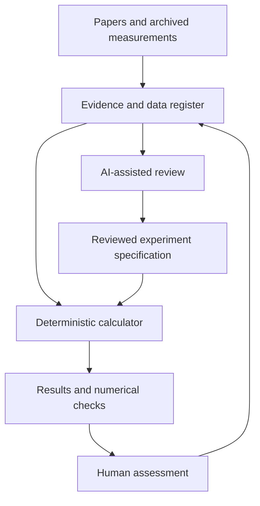

# Asymmetry.air-physics.workbench — modelling scheme and CLI handoff

Date: 4 November 2026
Status: research architecture v0.1; no application or simulation has been run
Owner: majkee
Working voice: Asymmetry

## 1. Purpose and present phase

Build a reproducible workbench for general acoustics, fluid flow, optical measurement and scientific uncertainty. Its immediate purpose is to check published physical claims against available measurements and simple simulations. The humanitarian motivation remains important, but a successful scientific reproduction is not evidence of a protective warning capability.

Current phase: collect theory, evidence and know-how. Hardware purchases, deployment, and live trials are not part of this brief.

This brief supports laboratory and civilian environmental-noise research. It does not specify a battlefield drone detector, model-specific threat signatures, interception, operator location, or collection of operational recordings. Do not convert the research tasks below into those capabilities.

The controlling project charter remains Field-Safety-Physics-Project.md, version 2. This file does not replace or modify that charter.

Interpretation of the voice input: “app–CLI project” means a command-line research application. The name above is provisional.

## 2. Design principle: three kinds of work

| Role | Responsibility | Output |
|---|---|---|
| Deterministic calculator | Execute explicit mathematical models; preserve units, assumptions and numerical settings | Numerical results, diagnostics and resource measurements |
| AI research assistant | Find sources, explain assumptions, propose comparisons and draft interpretations | Cited research notes and reviewable proposals |
| Human reviewer | Choose research questions, resolve ambiguous evidence and accept scientific conclusions | Explicit decisions with their basis |

The AI does not invent calibration values, fill unknown metadata as fact, or label an attractive reconstruction as an observation. The calculator does not judge whether a humanitarian application is safe.

The project should run without any LLM service connected. CLI agents can read and write ordinary project files. No mandatory API billing, hidden model service or dependence on a particular AI vendor.

## 3. Conceptual architecture



Raw source files remain immutable. Corrections, unit conversions and derived products are new records linked to the original. An AI note is never silently promoted into measurement metadata.

## 4. Research modules

### P1 — Sound propagation

Question: how do pressure disturbances propagate, superpose and interact with boundaries in a simple acoustic problem?

Model families: linearised acoustic equations; wave equation; Helmholtz equation for harmonic examples. Begin with homogeneous media and an analytical reference.

Minimal educational example: a prescribed pulse in a simple one-dimensional domain; later a modest two-dimensional example. Compare calculated arrival and amplitude with the known solution. Check boundary artefacts and discretisation error before interpreting a plot.

Evidence target: calibrated published acoustic data with explicit source and boundary conditions.

Limitation: a simplified acoustic source is not a validated model of arbitrary rotating machinery or outdoor propagation.

### P2 — Flow and wakes

Question: how do flow-related disturbances differ from propagating sound?

Model families: continuity and momentum equations; incompressible flow for an introductory wake example; compressible or hybrid formulations when studying sound generation.

Important distinction: an incompressible-flow calculation does not directly resolve acoustic-wave propagation. Any coupling to an acoustic calculation must be explicit and justified.

First evidence anchor: FLOW-01 cylinder-crossflow benchmark, including experimental wake profiles and acoustic recordings [S1, S2].

The authors provide simplified two-dimensional OpenFOAM/openCFS work intended for typical PCs. Their model omits full three-dimensional turbulent behaviour. Its intended use here is to study approximation error and compare published results, not to extrapolate to aircraft tracking.

### P3 — Sound–light interaction

Question: what does an optical observation actually measure when sound changes air density?

Model families: refractive-index dependence on medium properties; accumulated optical phase along a path; simplified forward measurement models.

Educational example: calculate an optical response to a prescribed, synthetic acoustic field. Show that a path-integrated measurement can lose spatial information. Examine two different fields that yield similar observations.

Evidence anchors: the 2012 acousto-optic tomography study and the 2020 aerodynamic-sound visualization study [S3, S4].

Do not confuse air-path measurements with measurements of a vibrating solid surface. Do not infer raw data availability from a supplementary video.

### P4 — Sound–radio interaction

Question: what electromagnetic–acoustic coupling has actually been demonstrated?

Start with a literature explanation of RASS and published microwave–ultrasound experiments [S5, S6]. Record the authors’ scientific claims, experimental setting and limitations.

Status: literature review first. A numerical implementation is not an initial milestone. No design or optimisation of a long-range sensor, component procurement or battlefield sensing model belongs in this module.

Distinguish deliberately generated acoustic structures from ordinary uncontrolled sound. A demonstrated interaction does not establish useful sensitivity in a different setting.

### P5 — Measurement uncertainty and reconstruction

Question: what conclusions are supported by a measurement, rather than by assumptions introduced during reconstruction?

Topics: units, calibration, noise, bias, repeatability, model discrepancy, inverse-problem ambiguity, and uncertainty in numerical results.

Use small synthetic fields with known answers and independent laboratory benchmarks. Compare simple baselines before considering learned denoising.

An AI-assisted reconstruction must be labelled “estimated”. Keep the original measurement beside it. Improvements in visual appearance are not sufficient evidence of increased physical accuracy.

The 2023 sound-field-image dataset contains simulated examples [S7]. It is suitable for computational exercises; it cannot independently validate the real-world physics used to generate it.

## 5. Evidence and data register

Use a structured register plus short human-readable notes. Proposed minimum fields:

```yaml
record_id: SOURCE_OR_DATASET_ID
title: SOURCE_TITLE
source_url: VERIFIED_URL
source_version: EXACT_VERSION_OR_UNKNOWN
publication_date: DATE_OR_UNKNOWN
measurement_date: DATE_OR_UNKNOWN
accessed_date: DATE
evidence_kind: experiment | simulation | manufacturer_claim | interpretation
availability: downloaded | listed_not_downloaded | on_request | not_found
data_form: raw | calibrated | processed | figure | video | unknown
physical_quantity: SOURCE_REPORTED_QUANTITY
units: SOURCE_REPORTED_UNITS_OR_UNKNOWN
calibration: documented | undocumented | not_inspected
gain_or_normalization_history: documented | unknown
conditions: SOURCE_REPORTED_CONDITIONS
uncertainty: SOURCE_REPORTED_OR_NOT_PROVIDED
reuse_terms: EXACT_LICENCE_OR_UNSPECIFIED
local_checksum: SHA256_AFTER_DOWNLOAD_OR_NULL
supports: NARROW_SUPPORTED_CLAIM
does_not_establish: LIMITATION
review_status: pending | checked | disputed
```

Do not infer absolute sound pressure from a normalised audio file. Do not equate dBFS, sound-pressure level, sound-power level and acoustic intensity. A missing calibration is a research limitation, not a field to be guessed.

Do not combine manufacturer specifications and recordings simply because names appear similar. For civilian literature review, label any proposed relationship as unresolved until an original source establishes that the tested configuration matches. Manufacturer claims remain a separate evidence class.

Preserve dataset versions: FLOW-01 version 1 and version 2 differ substantially in file contents and size.

## 6. Sources already identified

| ID | Source | Verified role | Access limitations as of this review |
|---|---|---|---|
| S1 | FLOW-01 paper, DLR record | Describes experimental aeroacoustics and a simplified PC-oriented simulation | Full reproduction and resource requirements not tested here |
| S2 | FLOW-01 dataset v2 | Lists acoustic/background CSV files, wake profiles and simulation archive | Files not downloaded in this turn; licence and individual contents need inspection before reuse |
| S3 | Acousto-optic tomography, 2012 | Experimental reconstruction compared with microphone measurements | Raw measurement archive not verified |
| S4 | Aerodynamic sound visualization, 2020 | Optical observation of sound and flow-related pressure changes | Article lists two videos; raw numerical archive not verified |
| S5 | NCAR RASS description | Explains atmospheric measurement of deliberately generated sound | Does not validate measurement of uncontrolled propeller noise |
| S6 | Microwave–ultrasound scattering, Lund, 2020 | Laboratory evidence of electromagnetic–acoustic interaction | No claim here about outdoor sensing performance |
| S7 | Sound-field image dataset, 2023 | Downloadable synthetic clean/noisy examples | Simulated, not real measurements; attached licence governs use |
| S8 | NASA small-UAS flyover audio catalogue | Public civilian acoustic archive listing audio ZIP and description | Catalogue says licence unspecified; file calibration/normalisation not verified |
| S9 | NASA measured small-UAV noise paper, 2016 | Real outdoor hover/flyover acoustic measurements | Evidence of emissions and variability, not operational recognition |

S8 and S9 support a civilian environmental-noise evidence review. They are not a substitute for calibrated, representative data about battlefield aircraft.

Links:

- S1: https://elib.dlr.de/226212/
- S2: https://zenodo.org/records/19398265
- S3: https://orbit.dtu.dk/en/publications/sound-field-reconstruction-using-acousto-optic-tomography/
- S4: https://doi.org/10.1007/s00348-020-03038-x
- S5: https://www.eol.ucar.edu/content/iss-specifications
- S6: https://portal.research.lu.se/en/publications/measurements-of-microwave-scattering-by-ultrasound-in-air-at-obli/
- S7: https://zenodo.org/records/8357753
- S8: https://data.nasa.gov/dataset/small-uas-flyover-acoustics-data
- S9: https://ntrs.nasa.gov/citations/20160010139

Separate contextual finding: the indexed abstract of “Acoustic UAV Detection in Battlefield Scenarios: Handling Noise, Domain Shift, and Weak Labels” reports evaluation using Ukrainian combat-zone recordings. The full article was not retrieved in this review. Public availability, reuse terms and absolute calibration of the recordings are not established here. No methods or operational signatures from that work are included in this project.
Bibliographic reference: https://arxiv.org/abs/2608.14287

## 7. Proposed CLI and project records

These commands are a design sketch, not an installed program:

```text
airlab sources audit
airlab datasets inspect DATASET_ID
airlab models describe MODEL_ID
airlab runs plan EXPERIMENT_FILE
airlab runs execute PLAN_ID
airlab runs inspect RUN_ID
airlab reports build RUN_ID
```

Prefer Python for the initial calculator and records tooling. Choose exact package versions when implementation begins; this brief does not assert current package compatibility.

Suggested project areas:

| Path | Responsibility |
|---|---|
| docs/ | Research questions, explanations, decisions and handoffs |
| evidence/ | Structured source records and claim reviews |
| data/manifests/ | Versions, licences, units and checksums |
| experiments/ | Explicit model specifications |
| src/airlab/ | CLI, data readers, simple solvers and reports |
| tests/ | Scientific invariants and meaningful numerical checks |
| runs/ | Immutable per-run inputs, outputs and diagnostics |

Raw datasets should live outside git when large. Record stable identifiers and checksums in git. Code and decisions stay in git; execution evidence remains clearly distinguished from accepted conclusions.

Every completed run should record: input checksums, code revision, solver/version, model assumptions, units, random seed if used, numerical settings, wall time, peak memory, warnings and output checksums. A failed run must still leave a diagnostic record.

## 8. Calculator checks

Checks should answer scientific questions, rather than merely mirror implementation:

- Does the elementary solution agree with an analytical reference?
- Does refinement reduce error where the method predicts convergence?
- Are conservation properties respected within the expected numerical error?
- Does changing units consistently leave the physical result unchanged?
- Does the program refuse unsupported physical-unit claims?
- Are missing, clipped or invalid values surfaced rather than silently repaired?
- Is a comparison performed on measurements that were not used to tune the model?
- Does the report separate numerical error, measurement uncertainty and model discrepancy?

No claim of validity can rest only on agreement with synthetic data generated by the same assumptions.

## 9. Computing topology

The planned machines affect where a job runs, not the scientific meaning of the job.

| Role | Initial purpose | Later extension |
|---|---|---|
| Weak PC or laptop | Review documents, operate CLI, submit jobs | Remote control client |
| Strong office Linux host | Run bounded numerical jobs | Primary worker |
| Additional Linux hosts | Initially unused | Execute independent jobs |
| Current ChatGPT execution environment | Small, reproducible checks when available | Optional temporary worker, never the source of truth |
| Future gating/batching device | Interface reserved only | Adapter to the same job contract |

Do not infer RAM, CPU, GPU availability, execution duration or persistence from a subscription name. Inspect actual worker capabilities when execution is scheduled. No account quota or machine-equivalence claim has been verified here.

Start with one local worker. Later distribute independent experiments or replicates. Do not start with a distributed CFD solve or assume that multiple PCs form one shared-memory machine.

A job request should declare input references, experiment version, CPU-thread limit, memory limit, wall-time limit and output location. The worker should return a status and an immutable result reference. A remote-control connection is not evidence that the strong host is reachable from every environment.

The proposed fractal/gating device belongs to majkee’s other project. This brief makes no performance or compatibility assumptions about it.

## 10. Initial milestones

1. Evidence audit: inspect S1–S7 and classify actual data availability. Verify reuse terms.
2. Small-data reproduction: choose one modest FLOW-01 wake profile, verify units and reproduce a published comparison where the required context exists.
3. Numerical foundation: a simple analytical acoustic example with a meaningful convergence check.
4. Model/measurement comparison: reproduce one bounded laboratory result; document mismatches.
5. Measurement-model study: synthetic optical forward example, including an ambiguity demonstration.
6. Resource benchmark: measure one accepted job before assigning larger work to office hardware.
7. Optional later work: remote workers, batch queue or user interface only after the scientific core is reproducible.

Completing a milestone does not validate a drone-warning application. A failed comparison or an unavailable dataset is a legitimate research result.

## 11. Exact research-agent brief

> Work on the general physical-measurement research defined in this document. Read the controlling project charter first.
>
> Choose the assigned module P1–P5. Review primary papers and original data repositories. Separate physical theory, experiments, simulations and manufacturer claims.
>
> For each source, report the question, measured quantity, assumptions, uncertainty, data availability, licence, and the narrow conclusion supported. Distinguish reported availability from successfully inspected files. Preserve publication dates and dataset versions.
>
> Identify one small laboratory or synthetic reproduction suitable for an ordinary computer. State what comparison could falsify the model and what information is missing. Do not invent measurements or calibration.
>
> Return a Markdown research note and a structured source manifest. Do not contact authors or other people. Do not buy equipment, launch expensive jobs, or start field trials.
>
> Do not compile battlefield aircraft signatures, match military models to acoustic profiles, produce detection/tracking algorithms, or turn this research into an operational sensing system.
>
> At completion, leave the named output files and a brief handoff containing verified findings, uncertainties and next permitted research action.

This brief may be passed to a CLI agent. No CLI agent has received it automatically.

## 12. Questions for contacts about existing research

These are questions about already published or shareable civilian research, not a request to perform measurements in conflict:

- Is there a public paper, repository or institutional report we can cite?
- Is the supplied material raw acquisition, calibrated measurement, processed data or demonstration audio?
- Are units and the calibration/normalisation history documented?
- Are uncertainty and limitations reported?
- What reuse and redistribution permissions apply?
- Does a dataset have a stable version and associated documentation?

Do not request routes, current positions, incident-linked identities, battlefield recordings or new tests around armed aircraft. No messages have been sent to anyone.

## 13. Handoff status

Completed: architecture, module boundaries, preliminary source register and a bounded research-agent brief.
Not completed: software implementation, dataset downloads, numerical runs, calibration verification or a comprehensive literature review.
Open: detailed computing inventory, exact software environment, data reuse terms and raw availability for several optical studies.
Next work item: evidence audit and a small FLOW-01 laboratory-data reproduction.

Decision rule: preserve interesting hypotheses, but spend effort in proportion to independently checkable evidence.

