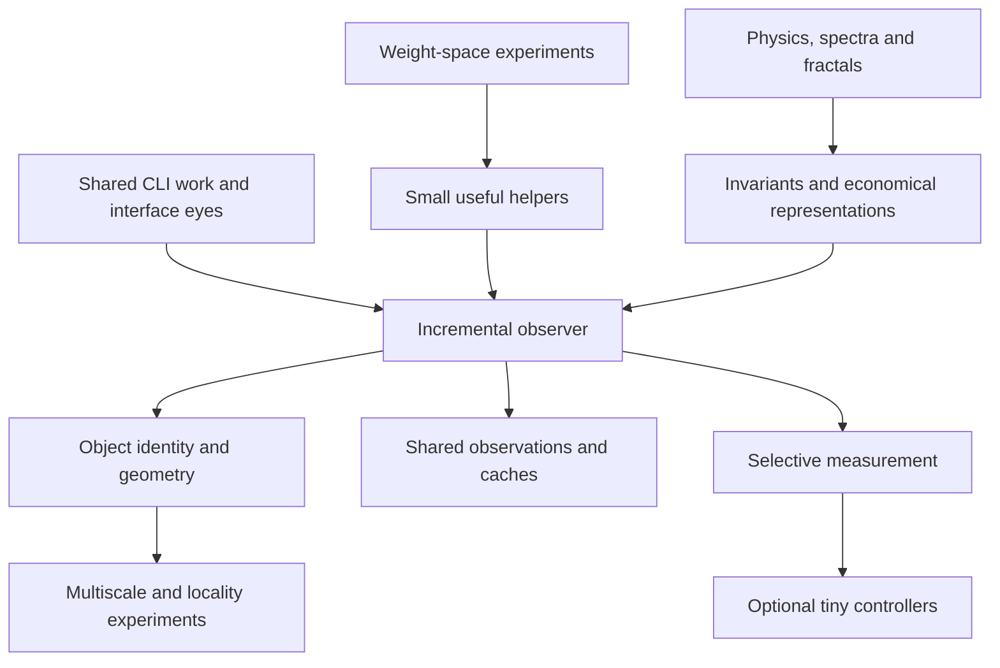

# Incremental observer for CLI agents

## Start here

Build a small component that maintains a reusable description of an interface, calculates predictable changes, and requests new evidence where its description may be wrong. Its consumers are native CLI agents. Its first environment is a synthetic interface, followed by a controlled local browser fixture.

**The objective is less observation and reasoning work at the same task correctness.** A useful result might be an exact coordinate transform, a better invalidation rule, a shared observation cache, or a tiny learned scheduler. Neural networks and fractal methods are candidates, not requirements.

This handoff is deliberately sufficient to begin without a new ChatGPT project or a new repository service. Use a small isolated working directory in an appropriate existing checkout. Promote the component into its own project when it has a working contract, evidence of usefulness and more than one consumer or adapter.

The implementation specification and the story belong together. Chapters 1–2 preserve the journey and open attractions; chapters 3–10 provide the engineering route; chapter 11 gives the activation instruction and required return artifacts. The default first assignment is **P0 only**. Later phases describe direction, not work already completed.

### Contents

1. [The story and mental map](#1-the-story-and-mental-map)
2. [Attractions we should not lose](#2-attractions-we-should-not-lose)
3. [Purpose and boundaries](#3-purpose-and-boundaries)
4. [Architecture and evidence](#4-architecture-and-evidence)
5. [Geometry and mathematical tools](#5-geometry-and-mathematical-tools)
6. [Identity events and shared state](#6-identity-events-and-shared-state)
7. [Measurement scheduling and tiny controllers](#7-measurement-scheduling-and-tiny-controllers)
8. [Phases and acceptance experiments](#8-phases-and-acceptance-experiments)
9. [Resource limits and implementation choices](#9-resource-limits-and-implementation-choices)
10. [How to propose another experiment](#10-how-to-propose-another-experiment)
11. [CLI activation and return contract](#11-cli-activation-and-return-contract)
12. [Sources and relationship to earlier work](#12-sources-and-relationship-to-earlier-work)

## 1. The story and mental map

### 1.1 The immediate spark

The conversation began with an account of *Sparks of Weight-Space Programming*: a large model identifying properties of other networks and directly constructing or editing their weights. We separated the reported experiments from the metaphor of an AI training its own friend. The useful engineering question became: could a large assistant help produce a **small specialist computation** that runs cheaply beside the native CLI? [S1]

Asymmetry proposed comparing such a network with a trained network and an ordinary handwritten program. The comparison matters: expressing a rule as weights does not automatically make it faster, more adaptive or easier to inspect. A transparent rule may remain the best implementation.

### 1.2 Why the hardware appeared

Majkee introduced Piql, a local privacy-gate project, and modest hardware. This was background for the possibility of small local helpers. Asymmetry initially followed that introduction into a hardware and implementation assessment; majkee redirected the discussion to the weight-space idea.

Keep that correction visible. This project is not primarily an Ollama tuning exercise or an extension of Piql. The latest working ceiling is 8 GB of system RAM. Older spare computers might provide portability checks. Buying additional hardware is not the first experiment.

### 1.3 The older mathematical seed

Majkee studied applied physics. Spectral analysis, differential equations and fractals were interests long before this conversation. Fractals were described as a “guilty pleasure.” Their reappearance was motivated by a search for economical representations and reusable structure, not a requirement to brand every mechanism as fractal.

The accompanying `fractal-hdd-tecnology.md` mixed real ideas—hierarchy, locality, parallel work and lazy computation—with unsupported general claims. Its ETH reference describes an industrial edge/IoT project, not evidence for an infinitely scalable graphical environment. [S2] Preserve the curiosity while testing specific mechanisms separately.

### 1.4 The practical threads converged

Two existing interests met here:

- Sharing useful session information and cached work between native CLI agents.
- Giving those agents access to interfaces through screenshots, structured readers, object maps, geometry and mouse actions.

The browser-navigation discussion also lives in another thread. Its implementation details should be reconciled when available; this handoff does not invent that thread’s current API or repository state.

The important question became: can mathematics explain much of the change between observations, leaving only a small remainder to inspect? A window moving does not necessarily mean its children changed. A scroll may move many objects through one transformation. Conversely, a one-word change or disabled button can matter while its geometry stays identical.

### 1.5 How the proposal changed

The first saved playground focused on tiny cache-admission controllers. That remains a useful bounded experiment. Majkee’s explanation then clarified the broader center: **an incremental observer that maintains a shared, versioned scene description**. Cache admission, spatial layout and learned measurement scheduling are possible parts of it.

This handoff changes the default order accordingly: establish identity, geometry, evidence and replay correctness first; investigate learned controllers after that foundation can measure their benefit. The earlier cache-only experiment can still be run independently.

### 1.6 The intent behind “lifehacks” and “baby”

Majkee called this a journey toward lifehacks that actually help us. He also asked that a small “baby” remain possible despite limited equipment or an ambitious larger vision. Interpret this as permission to incubate a useful component, and to discover an unexpected narrow application.

A negative result for neural caching need not invalidate the observer. A useful transform or parser can survive. The component’s job and evidence should remain portable when its implementation, language or model vendor changes.



## 2. Attractions we should not lose

This is a research map, not a list of promised features. A CLI implementer may find a better test than the first one proposed here.

| Attraction | Question worth preserving | Small discriminating test | Present position |
| --- | --- | --- | --- |
| Invariance | Which facts survive movement, scrolling or zoom? | Predict pure scroll; measure exceptions | Main first path |
| Shared session work | Can another CLI reuse evidence without repeating capture and parsing? | Two readers consume the same revision | Main first path |
| Multiple sources | Where do structure, geometry and pixels disagree? | Change pixels without changing DOM structure | Browser phase |
| Spectral methods | Can image translation be estimated cheaply when metadata is absent? | Phase correlation on bounded screenshot regions | Optional measured branch |
| Fractals and scale | Does recursive subdivision let us keep detail only where useful? | Flat regions versus quadtree under the same queries | Optional measured branch |
| Spatial locality | Does actual storage order improve traversal? | Row-major versus Morton layout | Separate ablation |
| Weight programming | Can a useful rule be constructed directly as weights? | Require a rule and its network to agree exactly | Small control experiment |
| Learning | Can past examples improve decisions about what to measure next? | Tiny model versus deterministic scheduler | After a reliable baseline |
| Local specialization | Can the helper work without a resident language model? | Frozen numeric controller and plain schema | Design preference |
| Agent perspective | What must survive compression for the next decision to remain correct? | Tiny semantic change with unchanged geometry | Core correctness question |
| Portability | Can we preserve the job while changing language or vendor? | Same trace and contract in another implementation | After usefulness |

Do not quietly collapse these into a single “fractal AI” hypothesis. A layout improvement, a better cache policy and reduced image capture are different effects. Isolate them before combining them.

Differential equations remain part of the intellectual origin. Smooth motion prediction could become relevant for animation, but interface transitions also contain discontinuities: navigation, replacement, popups and reflow. Add a dynamic model only if a measured task benefits from it.

## 3. Purpose and boundaries

### 3.1 What the observer returns

For a requested surface and object, return identity, relevant semantics, geometry, evidence origin, freshness relative to known revisions, and a clear statement of missing coverage. Support compact changes since a known revision as well as full snapshots.

Example consumer questions:

- Where is the current Save button in viewport coordinates?
- Is its enabled state recently observed, or merely remembered?
- Which regions changed since revision 41?
- Which measurements would resolve this uncertain target?

The consumer remains responsible for its task and decisions. The observer supplies evidence and calculated results.

### 3.2 Which cache we mean

| Cache | Scope here |
| --- | --- |
| Observation cache | Captures and structured reports with provenance |
| Derived-result cache | Parsed text, geometry projections and other computed representations |
| Shared scene state | A published description multiple CLI sessions can query |
| Model-internal KV cache | A different mechanism; this project does not provide cross-vendor access to it |
| OS page cache and CPU caches | Implementation context, not mechanisms we replace in P0 |

Sharing an external record does not guarantee identical understanding by different agents. Two browser tabs with the same URL are also not automatically the same scene.

### 3.3 Scope for the first delivery

P0 includes a synthetic scene, observation adapter, incremental state, deterministic scheduling, dependency checks, replay tests and file-based reader access. It needs no real mouse input, screenshots, browser process, network service or learned model.

The larger direction includes browser and possibly desktop/terminal adapters. It does not require a new window manager, renderer, operating system, distributed database or general-purpose local chat model.

## 4. Architecture and evidence

Use one authoritative observer process and multiple readers. Keep the implementation small enough that the data path is visible.

| Component | Responsibility |
| --- | --- |
| Adapter | Obtain permitted observations; declare capabilities and missing coverage |
| Normalizer | Validate schemas, units, source identity and event order |
| Scene store | Maintain objects, frames, versions and provenance |
| Geometry and dependency engine | Calculate projections and invalidate affected results |
| Scheduler | Choose bounded refresh operations; deterministic initially |
| Query interface | Return one coherent revision or an explicit incomplete result |
| Action coordinator | Later serialize input and revalidate targets; simulated in P0 |
| Evaluator | Compare outputs to independent truth, without supplying hidden facts to runtime |

### 4.1 Evidence origin is different from validity

Attach origin and validity to individual fields. A directly measured label can be old while a coordinate projection was just recomputed.

| Origin | Meaning |
| --- | --- |
| `observed` | A named source directly reported the value |
| `derived` | An exact declared calculation from recorded inputs |
| `predicted` | Extrapolated under an assumption that has not been rechecked |
| `inferred` | A heuristic or statistical interpretation, including uncertain identity matching |
| `unknown` | No usable value is available |

Use validity values `current`, `stale`, and `incomplete`. Here `current` means consistent with the observer’s latest applicable information. It is not a claim that the live UI could not have changed since capture. `unknown` carries a null value; stale historical values may be retained with their label.

An exact multiplication can still yield a prediction if the assumption that local geometry stayed unchanged is unverified. Record that assumption. Do not call every computed point a new observation. Numerical confidence is optional and must be defined or calibrated; an arbitrary percentage adds little.

Provenance propagates through calculations. Recomputing from a stale input does not make the result fresh. Predicted or inferred inputs preserve their assumptions and uncertainty in the output; multiplication alone cannot promote them to observed evidence. Use unqualified `derived` only when the required input validity and coverage support the calculation.

Distinguish an inspection query, which may return labelled estimates, from a factual query about the current target. The latter refreshes query-critical fields under the declared coverage policy or returns unknown. Setting `validity=current` is never sufficient by itself to satisfy that factual requirement.

### 4.2 Captures have timing and coverage

Record capture start/end times, source stream, epoch and sequence. Use sequence numbers for stream ordering; monotonic time is meaningful only within its clock domain. Wall-clock timestamps are diagnostic, not a global ordering guarantee.

A DOM read and a screenshot taken sequentially during animation are not an atomic snapshot. Start browser tests at stable, controlled checkpoints. Later record capture intervals and mark disagreement or uncertain coherence.

An adapter should declare whether it can observe geometry, text, enabled state, scrolling, mutations, pixels, focus and occlusion. An unavailable field stays unavailable. Lack of a mutation event does not prove that all visual or behavioral state stayed unchanged.

Screen text, DOM text and terminal output are untrusted content. Store them as data, not commands or instructions to the observer. Keep a route back to the original evidence so a lossy summary does not become the only account of what happened.

## 5. Geometry and mathematical tools

### 5.1 Coordinate frames

Start with object-local, scroll-content and viewport frames. Later add screenshot pixels and desktop coordinates. Every point and rectangle names its frame and units.

For the 2D affine prototype, use homogeneous column vectors, with matrices serialized row-major:

```text
p_viewport = T_viewport_from_content × T_content_from_local × [x, y, 1]^T
T_translate(dx, dy) = [[1, 0, dx], [0, 1, dy], [0, 0, 1]]
```

If content scrolls down by 120 CSS pixels, ordinary content points move upward by 120 viewport CSS pixels. Store that change once on the appropriate ancestor frame. Preserve child identity and local geometry where the model permits it. Browser `getBoundingClientRect()` reports viewport-relative geometry; distinguish it from document coordinates. [S3]

Transform all four rectangle corners when scale or rotation is introduced. An enclosing axis-aligned rectangle is not the actual shape or unobscured clickable area. Clipping, occlusion and hit testing need separate information. Nested coordinate transformations are established graphics behavior. [S4]

Do not assume screenshot pixels equal CSS pixels or desktop input units. Browser zoom, screenshot resizing, display scale, chrome offsets and multiple displays can affect the conversion. Store an explicit measured transform and its revision; test the round trip before coordinate input.

### 5.2 Prediction and residual

For a candidate transformation, predict a point and compare it with a fresh independent measurement:

```text
predicted_position = T × previous_position
residual = observed_position - predicted_position
```

Compute errors in a declared coordinate frame. Begin with translation only and deterministic fixture tolerances. Later robust estimates may use several matched anchors, but fitting anchors and verification anchors should be distinguished.

Residuals reveal failures of the chosen geometric explanation. They cannot prove unchanged text, enabled state or occlusion. A sticky element might need a separate frame or remeasurement rather than being forced into the ordinary scroll transform.

### 5.3 Invalidation by dependency

| Change | Invalidate or refresh | Often reusable, subject to its own evidence |
| --- | --- | --- |
| Parent translation | Dependent projected bounds and visible-region queries | Local bounds and text |
| Resize/reflow | Affected layout geometry, projections and hit regions | Established identity |
| Text/role/enabled update | Corresponding semantic fields and dependent decisions | Geometry if independently unchanged |
| Overlay appears | Visibility, hit targeting and actionability in covered regions | Underlying local geometry |
| Document navigation/restart | Old identities and all dependent live results | Historical records, explicitly historical |
| Source event gap | Completeness of affected state | Only facts whose coverage is demonstrably unaffected |

Dependencies include versions of local geometry, transforms, semantics, representation code and calibration as relevant. TTL may trigger a refresh; it is not a substitute for dependency checks.

### 5.4 Spectral and multiscale branches

Phase correlation estimates image translation using the Fourier shift theorem. OpenCV supplies an implementation. [S5] A bounded test could compare it with a known scroll offset on screenshot crops. Test animations, repeated textures and independently moving regions. Its response score is not automatically a calibrated probability that an object is unchanged.

Compare a simple image-difference method before adopting a more expensive spectral method. Neither should run when exact relevant movement information already answers the question at lower cost.

A quadtree or multiresolution representation can let us retain coarse global context and finer detail near a task. A hierarchy alone is not a mathematical fractal. Morton or Hilbert ordering is a separate storage/traversal hypothesis: changing dictionary keys without changing actual data arrangement does not establish a locality gain. Different spatial quality measures can favor different curves. [S6]

## 6. Identity events and shared state

### 6.1 Object identity

Use an object key `(surface_id, source_epoch, object_id)`. The surface identifies a particular window, tab or pane. The epoch changes on navigation, adapter restart or loss of reliable identity continuity. An object ID is stable only within its declared epoch and source guarantees.

Do not derive identity solely from coordinates, text, URL or list position. A replaced DOM node receives a new ID even if it looks identical. A browser adapter may assign IDs to actual DOM objects within a document. Recycled virtual-list nodes need semantic-version changes when their represented item changes; physical node continuity alone does not preserve action meaning.

For P0, the generator supplies exact IDs. Cross-epoch matching and visual tracking are later inferences, not hidden identity merges.

### 6.2 Event envelope

The following is a proposed concrete interface, not an existing API:

```json
{
  "schema": "observer.event.v1",
  "surface_id": "fixture-window-1",
  "source_epoch": "epoch-03",
  "source_seq": 42,
  "event_id": "fixture-window-1/epoch-03/42",
  "kind": "frame_transform_changed",
  "clock_domain": "fixture-process-1",
  "capture_start_ms": 12000,
  "capture_end_ms": 12001,
  "payload": {
    "frame_id": "content",
    "parent_frame_id": "viewport",
    "units": "css_px",
    "matrix_row_major": [1, 0, 0, 0, 1, -120, 0, 0, 1]
  }
}
```

Initial event kinds: `snapshot`, `object_upsert`, `object_remove`, `frame_transform_changed`, `source_gap`, `epoch_changed`. Use upserts for field changes. Each snapshot declares its covered scope and completeness.

The observer assigns `state_revision` after an accepted state change. Source sequence numbers and state revisions are different: one orders an input stream, the other orders published scene state.

- Exact duplicate event: no-op; do not apply movement twice.
- Same event ID with different content: reject and record a conflict.
- Gap, unexplained reordering or unseen old event: mark affected state incomplete and request a covering snapshot. Do not sort by wall time and guess.
- A full covering snapshot may explicitly recover across a gap. A partial snapshot cannot certify unobserved regions.
- New epoch: retire old live objects and invalidate old target handles.
- Unknown schema, non-finite geometry, invalid frame graph or dependency cycle: return a defined error.

Accept epoch transitions explicitly. A delayed event from a retired epoch must not reactivate that epoch. Define `object_upsert` as a field patch: omitted fields remain unchanged unless invalidated by dependencies; supplied fields replace their corresponding field records. Explicit `object_remove` retires an object, while an explicit null value with `origin=unknown` clears knowledge of a field. Validate the required identity and frame references when creating a new object.

A snapshot with complete structural coverage authoritatively replaces object membership within its declared scope: previously present objects omitted from that scope are retired. Partial snapshots cannot establish absence outside their coverage, and a geometry-only snapshot cannot establish that an omitted object was deleted.

Deduplication memory must be bounded. Retain a recent ID/hash window; an older event beyond that window triggers resynchronization if its status cannot be determined safely.

### 6.3 Field and snapshot examples

```json
{
  "object_id": "button-7",
  "observer_epoch": "observer-run-1",
  "field": "viewport_bounds",
  "value": [10, 40, 80, 24],
  "frame_id": "viewport",
  "units": "css_px",
  "origin": "predicted",
  "validity": "current",
  "method": "parent_translation",
  "assumptions": ["local_bounds_unchanged"],
  "evidence_refs": ["fixture-window-1/epoch-03/41", "fixture-window-1/epoch-03/42"],
  "updated_revision": 51,
  "depends_on": [
    {"ref": "object:button-7.local_bounds", "revision": 38},
    {"ref": "frame:content.transform", "revision": 51}
  ]
}
```

```json
{
  "schema": "observer.snapshot.v1",
  "observer_epoch": "observer-run-1",
  "surface_id": "fixture-window-1",
  "source_epoch": "epoch-03",
  "state_revision": 51,
  "source_seq_through": 42,
  "scope": {"kind": "surface"},
  "complete_for": ["fixture_structure", "fixture_geometry", "fixture_semantics"],
  "missing": ["raster_pixels"],
  "frames": [],
  "objects": [],
  "retired_object_ids": []
}
```

The empty arrays illustrate the envelope only. Real snapshots populate them. Include surface and epoch context when exporting fields separately. A scene can have complete synthetic structural coverage while individual geometric values are predictions under recorded assumptions.

### 6.4 Publication and cached results

For P0, publish a complete snapshot to a temporary file and atomically replace the snapshot file on the same local filesystem. Readers open one complete revision. Do not require them to assemble a scene from independently overwritten files. Add bounded JSONL event logs for diagnosis and replay, plus periodic snapshots. A truncated last log line after a crash must be detected.

A delta response names `base_revision` and `state_revision`, within an observer epoch. If the reader’s base is unavailable, return `resync_required` and a full snapshot. Never silently skip changes.

Derived cache entries contain their object key, representation kind/version and exact input dependency revisions. A hit requires matching dependencies and adequate input validity. Count histories, indexes, dependency edges and retained evidence in the memory budget. Retire old versions and bound log retention.

Scope dependency revisions to `observer_epoch`; revision 51 in a new observer run is not revision 51 in an old run. P0 should cold-invalidate persisted derived caches on observer restart. Bound tombstones to the retained delta window and require older readers to resynchronize. Never reuse an object ID within its source epoch. If an original capture is evicted, mark its evidence reference as unavailable rather than promising that it can still be retrieved.

SQLite can be considered later if file publication becomes inconvenient. WAL has same-host and filesystem constraints; it is not a shared database file to place across machines over a network mount. [S9] A future remote adapter should exchange versioned messages or serve queries through an explicit endpoint. P0 needs neither.

### 6.5 Multiple agents and actions

Several CLI sessions may read. Serialize input per surface through one owner. First test this with simulated commands only. A proposed action request contains surface, source epoch, expected observer epoch/revision, target ID and intended action.

At the head of the queue, reject stale requests or return a refreshed target for reconsideration. Before later real input, reobserve identity, state, relevant geometry and hit targeting. Prefer a semantic element operation when available. After input, verify the intended observable postcondition.

A lease or revision check coordinates our agents; it cannot freeze JavaScript, animations or a human operator. There remains a time-of-check/time-of-use gap. Do not describe stale checks as a universal guarantee of correct clicking.

## 7. Measurement scheduling and tiny controllers

### 7.1 Deterministic scheduler first

Start with explicit rules: refresh incomplete state; invalidate known dependencies; remeasure query-critical stale fields; bound the age of reused fields; periodically audit regions even when no changes are reported. The concrete age/audit thresholds are configuration recorded in each run and tuned on development fixtures only.

A compact query response should include the requested facts and unresolved fields. It should not serialize the entire scene for every question. Keep payload accounting in the benchmark: small internal structures are of limited help if each query produces a huge text dump.

### 7.2 A possible learned task

A tiny controller could rank measurement actions such as `reuse`, `project_geometry`, `refresh_structure`, `refresh_region`, or `request_full_observation`. It advises expenditure of work; it does not certify reality unchanged or bypass the exact invalidation rules.

Causal features might include observation age, geometric residual, event completeness, recent changes, region activity and the relevance of a field to the current query. Do not treat raw confidence values from different sources as interchangeable. An out-of-range input or model failure uses the deterministic fallback and increments a counter.

The earlier 8 → 16 → 1 ReLU network contains 161 parameters, or 644 bytes of float32 weights and biases. That is a useful scale example for a binary decision. A multiple-action scheduler may need a different output shape; recalculate its parameter count rather than inheriting 161 by name. The interpreter, features and history usually matter more than this parameter-file size.

### 7.3 Experiments that distinguish representation from learning

1. Write a cheap deterministic rule.
2. Express that same rule as assigned network weights and require identical decisions.
3. Train a logistic model, then a small MLP if warranted, to improve a defined decision.
4. Measure net benefit over the existing deterministic system, including feature extraction and fallback costs.

For example, on a binary feature `x0` meaning “seen in the recent history,” the score `x0 - 0.5` implements a second-touch admission rule. This is a weight-programming control, not learned intelligence.

Use whole-session training/validation/test splits, a small fixed candidate count, recorded seeds and an unseen workload regime. Future information may create offline labels; it may not appear in runtime features. The controller only sees the observations its policy actually acquired, so replay the closed loop rather than evaluating predictions from an always-observed dataset alone.

Cache admission and measurement scheduling are different tasks. For cache admission, keep eviction fixed while changing admission. For scheduling, keep the query tasks and evidence requirements fixed while changing when measurements occur. Learned caching has existing precedents such as LRB; their results are not performance promises for this application. [S10]

## 8. Phases and acceptance experiments

### P0 — Synthetic observer and replay

Separate three components:

1. **Generator/oracle:** holds the complete simulated truth.
2. **Observation adapter:** reveals only requested measurements and declared event subscriptions.
3. **Observer:** consumes that evidence, maintains state and answers queries.

The evaluator may read the oracle to score results. Its full reads must not populate the observer or train a runtime policy during evaluation. Record evaluation-only costs separately. Runtime refreshes and action revalidation remain part of operational cost.

Compare full refresh before each query with a deterministic incremental observer. Both receive the same permitted sources, scenario and query schedule, starting from clean state. The full-refresh baseline should not pay for unused incremental bookkeeping.

Start with one translation-only scroll-content frame and a small set of objects. The up-to-20,000-event smoke workload exercises this initial supported scenario; the broader correctness suite uses small targeted fixtures, not 20,000 events for every edge case. Add independent fixed objects and a second scroll frame after the first tests pass. A query might request current target bounds, label and enabled state. Synthetic input may simulate selecting a target, but never operates the real desktop.

| Test | Required behavior |
| --- | --- |
| Pure scroll | Preserve identities and local bounds; project correct viewport bounds |
| Nested scroll | Apply only the relevant ancestor transformations |
| Reflow | Retire transform-only assumptions and refresh affected geometry |
| Same-looking replacement | Old target ID becomes unusable; replacement gets a new identity |
| Label or enabled change without movement | Update semantics; geometric agreement is insufficient |
| Overlay over unchanged target | Do not infer actionability from bounds alone |
| Duplicate, delayed and missing events | Follow declared deduplication/gap rules and recover |
| Navigation or restart | Old-epoch targets and cached results are rejected |
| Reader during publication | Read one complete revision, never mixed state |
| Two simulated action requests | Serialize; the second revalidates after the first changes state |
| Dependency mismatch | Recompute or return unknown; do not serve a stale cache hit |
| Many object versions | Metadata and logs remain within configured bounds |

Use a declared numerical tolerance, initially `1e-6` synthetic coordinate units. Require zero incorrect answers presented as verified current facts in the acceptance suite. Score explicitly labelled predictions and their errors separately. A factual answer requires the covering evidence described in chapter 4, rather than a `current` flag alone. Unknown is valid for insufficient coverage, but fully observable supported cases must still complete correctly; a system that always abstains does not pass.

Test both reliable event delivery and deliberately incomplete coverage. Do not use perfect synthetic event coverage as evidence that arbitrary real interfaces will be equally observable.

### P1 — Controlled local browser fixture

Use a local fixture containing ordinary scrolling, nested containers, fixed/sticky elements, resize-induced reflow, text changes, enabled-state changes and an overlay. Begin at stable checkpoints. Compare predicted geometry against fresh browser measurements collected independently by the evaluator.

When evaluator reads could force layout work or alter timing, use separate deterministic correctness and performance replays. Subtracting the evaluator's measured duration does not remove indirect perturbations. The timed policy still performs and pays for every refresh or target validation it would need in actual use; the performance run cannot quietly use a cheaper, less correct policy.

Use a single controlled browser/profile, separate from the user’s working tabs. Playwright is one possible fixture runner; its Firefox support uses its own patched build rather than the ordinary branded Firefox installation. [S7] A later adapter to the user’s existing browser requires a separately verified attachment mechanism. WebDriver BiDi supplies a relevant standardized protocol direction, but it remains a working draft and actual feature support must be checked. [S8]

`MutationObserver` reports configured DOM changes and `ResizeObserver` reports element dimensions. [S11, S12] They do not collectively prove that all visible pixels or hit targets are unchanged. Include an event-independent audit and test a visual change outside the structural signal’s coverage.

A proposed starting tolerance is one CSS pixel at stable checkpoints, tightened when the target’s usable hit area requires it. Separately validate any CSS-to-screenshot/input conversion. Test that the intended target receives the simulated or fixture-local action, not merely that a cursor coordinate was issued.

The browser process tree counts in memory and CPU results. If the fixture cannot run within the budget, report that limitation and retain P0; do not exclude the browser to claim compliance.

### P2 — Two CLI readers

Connect two native CLI consumers to the same published observer revisions. Prove that one can reuse a captured scene without triggering duplicate acquisition, and that a change invalidates the other reader’s affected result. Use synthetic or local-fixture actions through the single owner.

Do not synchronize a database by sharing it over a network filesystem. A second computer is initially a replay portability test, not a distributed-consistency requirement.

### P3 — Optional independent branches

Choose one branch at a time: image translation, multiscale regions, physical data layout, cache admission, or learned measurement scheduling. Hold other components fixed. The first successful deterministic observer remains the baseline.

### Metrics and decisions

Report task/query completion, wrong-current answers, unknown/deferred results, important changes missed, identity errors, geometry error and stale-action rejections. Alongside those, report full reads, regional reads, captures, OCR passes, bytes delivered, processing time, end-to-end latency, peak process-tree memory and retained metadata. Distinguish cold start from warm operation.

Before a campaign, name its primary cost metric. Default to total measured end-to-end time for the fixed operational query schedule, with queries issued serially at defined stable checkpoints; exclude scripted idle waits and separately identify acquisition and processing time. A different primary metric, such as operational CPU time, must be selected before seeing test results. Report capture counts, bytes, latency distribution and memory alongside it.

An initial project continuation target is at least 20% improvement in that predeclared primary metric at equal task correctness and comparable completion, across multiple held-out browser scenarios. Show per-scenario regressions and repetitions; a favorable mean does not hide a failure on overlays or reflow. This is our proposed decision threshold, not a scientific constant or a result already obtained.

Synthetic read-count savings establish a property of that synthetic workload. Modeled costs and estimates must be labelled. Only actual runtime measurements can establish an end-to-end speedup on a real workflow.

Park or narrow a branch if baseline refresh is cheaper, invalidation bookkeeping dominates, correctness depends on unavailable signals, or a learned model loses its benefit outside training conditions. Retain any independently useful mapper, schema or fixture.

## 9. Resource limits and implementation choices

### 9.1 Budget

The current design ceiling is an 8 GB host. Available memory must be checked on the actual machine. These are proposed controls, not measured guarantees:

| Resource | Initial budget |
| --- | --- |
| Worker count | One; no parallel browser test fleet |
| Numeric-library threads | One, verified against the active backend |
| P0 peak RSS target | Below 512 MiB |
| Whole-job memory limit | 1 GiB, including subprocesses |
| Smoke workload | Up to 20,000 compact events |
| Full trace maximum | 200,000 events, reduced if limits require |
| Individual trial | At most 10 minutes |
| First benchmark campaign | At most 30 minutes of runtime |
| Generated fixtures, logs and reports | At most 100 MiB initially |
| Model service or continuous training | None |

Browser installation size and dependency storage must be reported separately from generated traces. They still consume real disk capacity. In P1 begin with the same whole-job limit; a failed launch or budget overrun is an explicit unmet requirement, not a reason to raise limits silently.

On a suitable systemd/cgroup host, transient resource controls can apply `MemoryHigh=512M`, `MemoryMax=1G`, `MemorySwapMax=0` and `CPUQuota=100%`, with a wall-clock timeout. Verify the controls actually took effect. The CPU quota is one logical CPU’s worth of time; memory-high throttles/reclaims while memory-max can terminate the job. [S13] Do not alter the host’s swap configuration to conceal an overrun.

No claim of hardware health follows from these limits. Begin with the smoke run, observe responsiveness and reduce the workload if necessary. The old spare machines may run smaller replays; no hardware purchase is required to establish P0.

### 9.2 Technology choice

Use Python and its standard library for P0 where sufficient: JSON, files, deterministic generators, tests and timers. NumPy is optional for matrices/training; OpenCV and browser tooling belong to later branches. Thread controls for numeric libraries depend on the BLAS backend. [S14]

C++ or Rust becomes useful after a measured hot path exists or when building an integration in those languages. Port the same contract and replay tests. Compare a native learned controller with a native handwritten baseline so a language change is not misattributed to learning.

Prefer ordinary optimized libraries for standard calculations. The mathematical opportunity is often eliminating repeated work. Reimplementing a mature numeric primitive is a separate engineering cost that needs justification.

### 9.3 Suggested small repository shape

| Path | Purpose |
| --- | --- |
| `README.md` | Goal, supported phase and reproducible commands |
| `docs/story-and-hypotheses.md` | Preserve chapters 1–2 and later experiment links |
| `src/observer/` | Contract validation, scene state, geometry, dependencies and queries |
| `src/observer/adapters/` | Synthetic adapter first; browser later |
| `tests/` | Behavioral correctness and replay cases |
| `fixtures/` | Compact synthetic cases; later local HTML |
| `runs/` | Bounded generated evidence, normally ignored by git |
| `results/` | Small durable summaries and decision records |
| `_bus/` | Optional native-CLI request/response handoffs |

This is a suggested layout, not a mandate to scaffold empty subsystems. Do not add the future browser or neural package before it has executable work. Plain JSON contracts and portable fixtures matter more than the directory names.

For a git-backed implementation, commit source, tests, small reviewed summaries and the meaningful decision record. Treat raw captures as evidence with explicit retention and access rules; do not automatically commit private browser or terminal content.

## 10. How to propose another experiment

The story is meant to preserve freedom, not make the current design immune to criticism. An implementer who sees a cheaper or more revealing experiment should propose it clearly and test it within the active milestone’s scope.

Use this small record:

```text
attraction:
hypothesis:
why_this_could_help_our_workflow:
smallest_test:
baseline:
observable_success:
result_that_would_disprove_or_narrow_it:
required_inputs_and_coverage:
runtime_and_memory_budget:
what_else_must_stay_fixed:
result_and_next_decision:
```

Label statements as user intent, source finding, design choice, hypothesis or measured result where confusion is possible. Preserve failed tests and disagreements. Do not replace the goal of useful assistance with a goal of proving fractals, neural weights or a favored language superior.

A new component earns its own `asymmetry` project when it has a stable contract and replay suite, one useful measured workflow, a second consumer or adapter that benefits from the same core, and enough independent maintenance to justify the boundary. A separate conversation can be opened earlier for sustained research, but should begin from the files and decisions rather than relying on invisible history.

Three questions should stay alive:

1. What can we calculate because it remained invariant?
2. What must we measure because the available evidence cannot settle it?
3. What information must survive preprocessing for the agent’s decision to remain sound?

## 11. CLI activation and return contract

### 11.1 Paste this with the file path

> Read `Asymmetry.incremental-observer.cli-handoff.md`, including the story and attraction map. Read the applicable repository instructions and inspect the actual host. Implement P0 in an isolated working directory. First state your understanding of the goal, the resource budget, the observation/oracle separation, and the artifacts you will return; then proceed with the bounded work. Compare full refresh with deterministic incremental observation on the same seeded scenarios. Keep the exact identities, epochs, provenance and stale-state rules visible. Do not add browser capture, a local language model or training to make P0 appear more complete. Preserve useful alternate experiment ideas in the hypothesis record. Finish with reproducible tests, results and a decision about the next smallest useful step.

This is an implementation activation when majkee gives it to the CLI. The read-back is a check of understanding, not an extra permission checkpoint. Routine reversible work within P0 should continue. A genuine missing prerequisite or resource limit should be reported with the completed work and the smallest concrete unresolved decision.

### 11.2 Suggested command contract

The implementer may choose different names, but must provide equivalent one-command generation, replay, query and test operations. These examples are **interfaces to implement**, not commands claimed to exist today:

```bash
python -m observer generate --seed 17 --events 20000 --out runs/seed17
python -m observer compare --trace runs/seed17 --policies full,incremental --out results/seed17
python -m observer query --snapshot runs/seed17/snapshot.json --object button-7
python -m unittest discover -s tests
```

Generation must keep oracle truth separate from observer-visible records. A replay engine grants requested measurements through the adapter and records their cost. Export compact parameters and JSON schemas where useful; do not require a vendor SDK for the core replay.

### 11.3 Definition of the first delivery

- Runnable synthetic observer and full-refresh baseline, with documented environment setup.
- The P0 behavior tests, including meaningful failure/recovery cases, with actual results.
- A reproducible manifest: source revision, runtime/dependency versions, host characteristics, scenario parameters, seeds, limits and coverage configuration.
- A comparison CSV containing correctness, query completion, observation counts, runtime, memory and per-scenario outcomes.
- A short decision record that distinguishes measured findings, limitations and proposed next steps.
- The story and attraction map retained in the working documentation, with new ideas attached to the relevant branch.

If using the file-driven relay, activation can remain a pointer to the request file. The response file must exist at turn end and name the exchange ID and expected artifacts. Git holds reviewed source and decisions; terminal output and captures supply evidence. Evidence becomes an accepted result only with its measurement context and interpretation.

Suggested response outline:

```text
exchange_id:
goal_readback:
completed:
commands_to_reproduce:
tests_and_results:
resource_measurements:
known_failures_or_missing_coverage:
alternate_idea_preserved:
next_smallest_step:
artifact_paths:
```

## 12. Sources and relationship to earlier work

Technical sources checked during this conversation on 4 November 2026. They support the stated mechanisms, not this project’s unmeasured performance. Budgets, interfaces, thresholds and phase choices above are proposals.

- **S1:** [Sparks of Weight-Space Programming](https://rikiyat.github.io/blog/weight-space-programming/) and [released experiment records](https://github.com/RikiyaT/lm_understand-logs). Inspiration for direct weight construction; this handoff does not reproduce those experiments.
- **S2:** [ETH Zurich FRACTAL](https://iis.ee.ethz.ch/research/research-groups/Digital%20Circuits%20and%20Systems/current-projects/FRACTAL.html). Actual industrial edge/IoT scope of the attachment’s reference.
- **S3:** [MDN getBoundingClientRect](https://developer.mozilla.org/en-US/docs/Web/API/Element/getBoundingClientRect). Viewport-relative geometry and scrolling.
- **S4:** [W3C CSS Transforms](https://www.w3.org/TR/css-transforms/). Nested coordinate transformations.
- **S5:** [OpenCV motion analysis](https://docs.opencv.org/4.x/d7/df3/group__imgproc__motion.html). Phase correlation and its response measure.
- **S6:** [Haverkort and van Walderveen on locality and bounding-box quality](https://arxiv.org/abs/0806.4787). Distinct quality objectives for space-filling curves.
- **S7:** [Playwright browsers](https://playwright.dev/docs/browsers). Browser distribution/support boundaries, including Firefox.
- **S8:** [WebDriver BiDi](https://www.w3.org/TR/webdriver-bidi/). Remote-control protocol; working draft and implementation support must be distinguished.
- **S9:** [SQLite WAL](https://www.sqlite.org/wal.html). Concurrency and same-host constraints.
- **S10:** [Learning Relaxed Belady, NSDI 2020](https://www.usenix.org/conference/nsdi20/presentation/song). Learned caching precedent with overhead considered.
- **S11:** [MDN MutationObserver](https://developer.mozilla.org/en-US/docs/Web/API/MutationObserver). Configured DOM change observation.
- **S12:** [MDN ResizeObserver](https://developer.mozilla.org/en-US/docs/Web/API/ResizeObserver). Element-size observation.
- **S13:** [systemd resource controls](https://www.freedesktop.org/software/systemd/man/latest/systemd.resource-control.html). CPU, memory and swap control semantics; use the installed version’s supported controls.
- **S14:** [NumPy global configuration](https://numpy.org/doc/stable/reference/global_state.html). Numeric backend thread controls.

The earlier `Asymmetry.tiny-controllers.playground.md` remains the more detailed cache-admission experiment. Its optional nature and the wider observer-first ordering are clarified here. This document is self-contained for P0; a CLI need not access ChatGPT or the earlier file to begin. The attachment `fractal-hdd-tecnology.md` remains an idea source, with its unsupported claims excluded from acceptance criteria.
